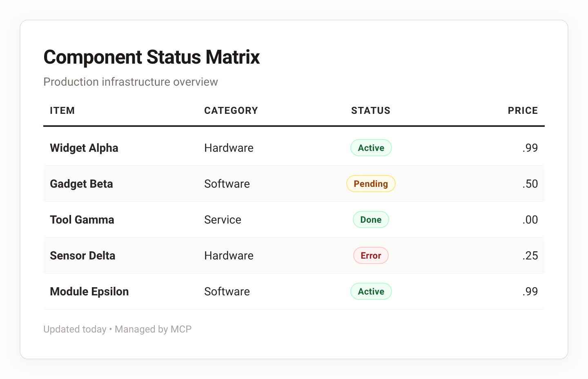
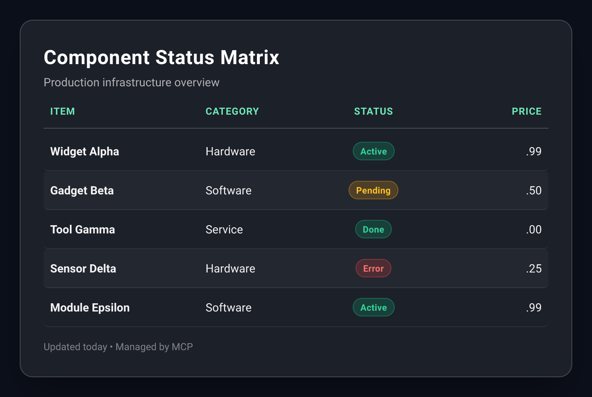
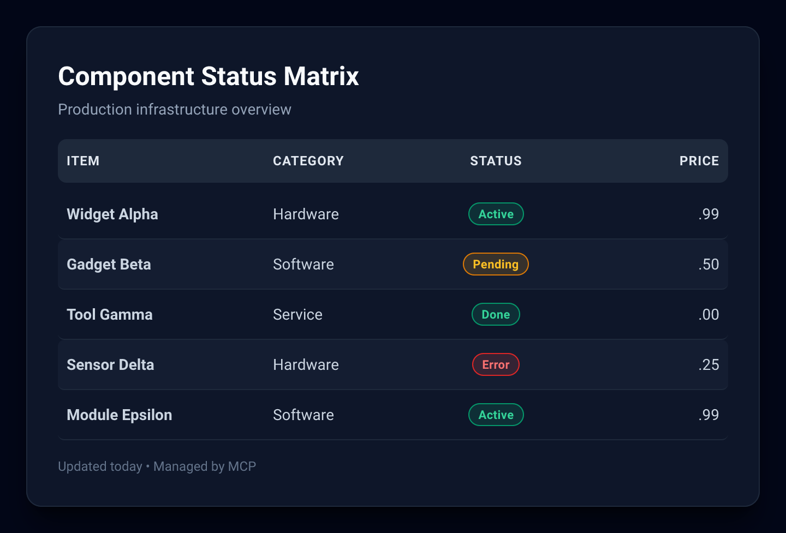
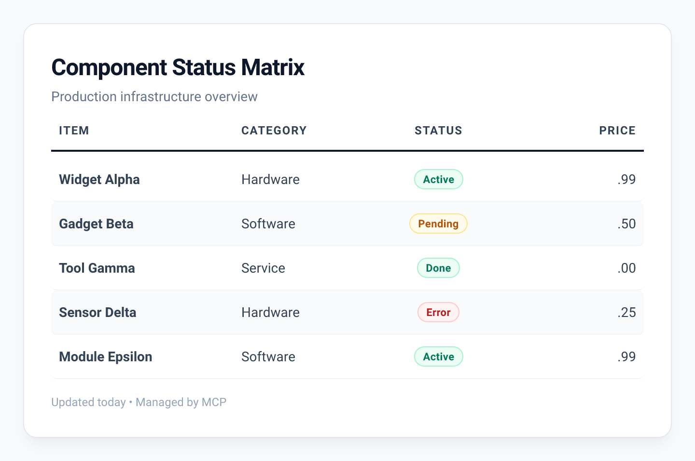
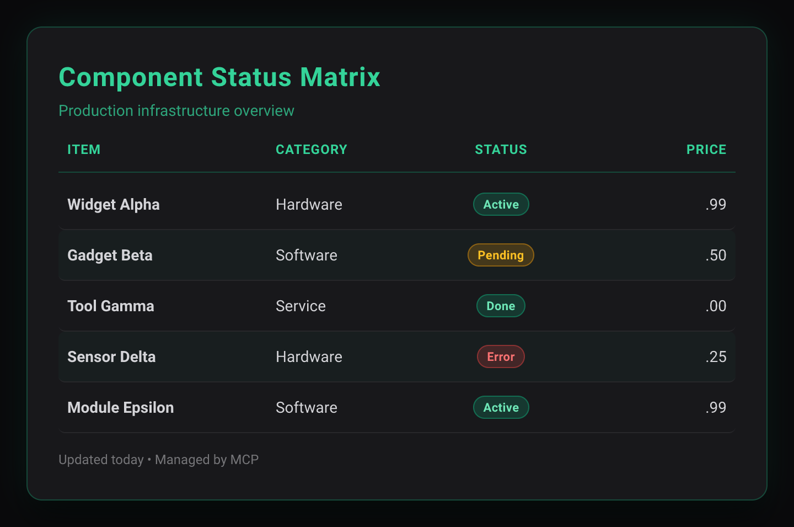
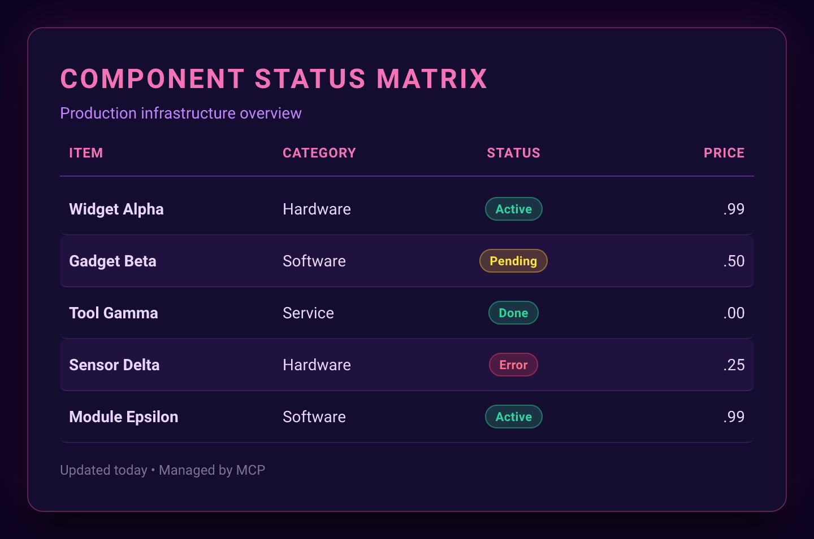

# markdown-table-to-image-mcp

A [FastMCP](https://github.com/punkpeye/fastmcp) server that converts Markdown tables into beautifully styled, high-DPI image cards (PNG, WebP, or JPEG). Pipe any Markdown table through a single MCP tool call and get back a publication-ready image card or save it directly to disk.

## Features

- **6 built-in themes** — `glassmorphism`, `slate-dark`, `minimalist-light`, `emerald-glow`, `synthwave`, and the new publication-grade `editorial`
- **Modern CSS Grid layout** — intelligent proportional column weighting that prevents text truncation or cramped columns
- **Rich inline typography** — full inline Markdown parsing (`**bold**`, `*italic*`, `~~strike~~`, `` `code` ``, `[links](url)`) powered by bundled `Roboto` and `Roboto Mono` fonts
- **Automatic status badges** — semantic status keywords (`Active`, `Passed`, `Pending`, `Failed`, `Error`, `In Progress`, `✓`, `Draft`) render automatically as styled pill badges
- **Header & footer metadata** — optional `title`, `subtitle`, and `footer` captions for complete standalone cards
- **Flexible aspect ratios** — `auto` (shrinks to content), `16:9`, `1:1`, `9:16`
- **Multiple output formats** — `png` (default), `webp`, and `jpeg`
- **Direct file saving** — optional `outputPath` parameter writes the generated image directly to disk
- **Transparent background controls** — independent options for transparent card panel (`transparentBackground`) or fully transparent canvas (`transparentCanvas`) for video/slide overlays
- **Zebra striping** — subtle alternating row tints with customizable toggle (`zebraStriping`)
- **High-DPI output** — configurable scale multiplier (default `2x`) for Retina-sharp graphics
- **Zero-cold-start cache** — in-memory LRU cache serves identical table renders instantly

## Quick Start / Setup

### 1. Run with npx (recommended)

You can run the server directly without cloning:

```json
{
  "mcpServers": {
    "markdown-table-to-image": {
      "command": "npx",
      "args": ["-y", "markdown-table-to-image-mcp"]
    }
  }
}
```

### 2. Local installation

```bash
git clone https://github.com/kweinmeister/markdown-table-to-image-mcp.git
cd markdown-table-to-image-mcp
npm ci
npm run build
```

Configure your client (replace `/absolute/path/to/markdown-table-to-image-mcp` with your local directory):

```json
{
  "mcpServers": {
    "markdown-table-to-image": {
      "command": "node",
      "args": ["/absolute/path/to/markdown-table-to-image-mcp/dist/server.js"]
    }
  }
}
```

## Tool Reference

### `markdown_table_to_image`

Converts a Markdown table string into a styled image card.

| Parameter | Type | Default | Description |
| :--- | :--- | :--- | :--- |
| `markdown` | string | *required* | Raw Markdown table (must include header and separator rows). Max 50,000 chars, 50 columns, 500 rows. |
| `title` | string | — | Optional title displayed above the table card. |
| `subtitle` | string | — | Optional subtitle or description displayed directly beneath the title. |
| `footer` | string | — | Optional footer or source attribution displayed below the table. |
| `theme` | string | `glassmorphism` | Visual theme: `glassmorphism`, `slate-dark`, `minimalist-light`, `emerald-glow`, `synthwave`, or `editorial`. |
| `format` | string | `png` | Output format: `png`, `webp`, or `jpeg`. |
| `outputPath` | string | — | File path on disk where the rendered image should be saved directly (directories created automatically). |
| `aspectRatio` | string | `auto` | Canvas proportions: `auto`, `16:9`, `1:1`, `9:16`. |
| `scale` | number | `2` | High-DPI multiplier (0.5–4). Use `2` for Retina sharpness. |
| `customWidth` | integer | `800` | Canvas width in logical pixels (200–3840). |
| `transparentBackground` | boolean | `false` | Renders the card panel without a fill. |
| `transparentCanvas` | boolean | `false` | Renders the canvas transparent for slide/video overlays. |
| `zebraStriping` | boolean | `true` | Subtle alternating background tint on even rows. |
| `statusBadges` | boolean | `true` | Automatically renders status values as colored semantic badges. |

#### Example Prompt

```text
Convert this table to an editorial-themed image with a subtitle and save it to ./docs/benchmarks.png:

| Subsystem | Engine | Status | Latency |
| :--- | :--- | :---: | ---: |
| **Parser Core** | `FastMCP v4` | Active | ~1.2ms |
| **Layout Grid** | `Takumi CSS Grid` | Passed | ~3.8ms |
| **Mono Badges** | `Roboto Mono` | In Progress | ~0.5ms |
| **Output Sink** | `Direct Disk Write` | Done | ~0.9ms |
```

## Themes

| Theme | Description | Preview |
| :--- | :--- | :--- |
| `editorial` | Clean publication layout, stone typography, subtle borders, and warm contrast |  |
| `glassmorphism` | Frosted-glass panel on a dark slate canvas with emerald accents |  |
| `slate-dark` | Deep navy/slate background with clean high-contrast text |  |
| `minimalist-light` | Ultra-clean white card on light background, publication-ready |  |
| `emerald-glow` | Dark terminal aesthetic with vivid emerald neon borders |  |
| `synthwave` | Retro neon purple and pink gradients on a deep violet background |  |

## Development

```bash
npm run dev        # Live reload via tsx watch
npm run lint       # Run Biome linting and formatting check
npm run typecheck  # Run TypeScript compiler (noEmit)
npm test           # Run the Vitest test suite
npm run build      # Compile to dist/ for production
```

## Tech Stack

- [FastMCP](https://github.com/punkpeye/fastmcp) — MCP server framework (stdio transport)
- [Takumi](https://github.com/kane50613/takumi) — Rust-based JSX image rendering engine
- [Zod](https://github.com/colinhacks/zod) — Schema validation
- [Biome](https://biomejs.dev/) — Formatting and linting
- [Vitest](https://vitest.dev/) — Fast unit testing
